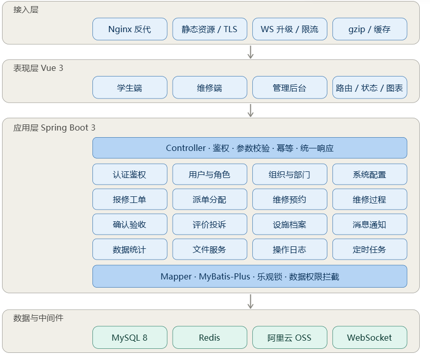
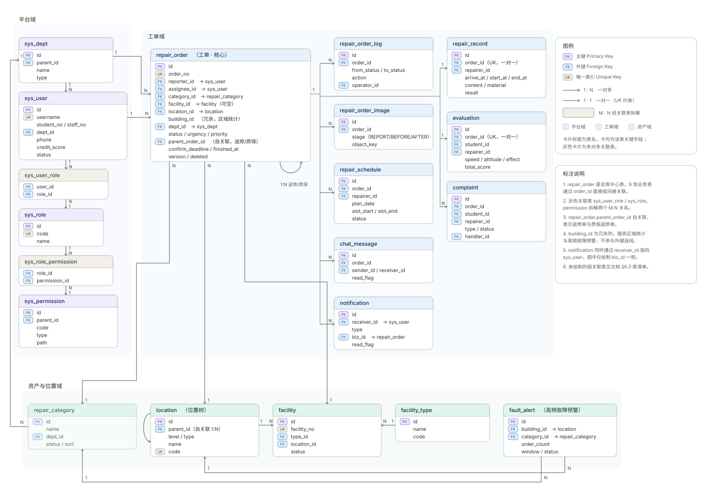

# CampusFix 系统设计说明书

| 项 | 内容 |
|---|---|
| 文档名称 | CampusFix 校园设施报修与工单管理平台 — 系统设计说明书 |
| 版本 | v2.7 |
| 日期 | 2026-10-31 |
| 状态 | 设计定稿（可进入编码） |
| 上游依据 | `CampusFix.md`（原始需求）、`CampusFix-项目注意文档.md` v1.1（设计基线） |
| 冲突处理 | 与基线文档冲突时以基线文档为准；本文件负责把基线**转化为可实现的结构** |

---

## 1. 引言

### 1.1 编写目的

把已确认的业务决策（24 条）转化为可直接编码的工程结构：分层与模块、数据流、接口契约、数据库结构、部署形态、非功能指标与风险取舍。开发人员应能仅凭本文件 + 基线文档完成实现，不需要再回头猜测业务规则。

### 1.2 范围

**包含**：后端 16 个业务模块的结构与职责、10 状态工单状态机、抢单/派单/预约/返修/验收全链路、25 张表的物理结构、约 70 个 REST 接口契约、单机部署方案、非功能指标。

**不包含**：微信小程序实现（仅预留）、短信/邮件通道、多租户、计费、硬件对接（门禁/物联网设备）。

### 1.3 读者对象

后端开发（主）、前端开发（接口契约与状态枚举）、测试（状态机与异常分支）、部署运维（第 7 章）。

### 1.4 术语与缩写

| 术语 | 英文/标识 | 说明 |
|---|---|---|
| 工单 | Repair Order | 系统核心业务对象，一次报修的全生命周期载体 |
| 报修人 | Reporter | 提交工单的用户，任何角色均可 |
| 维修工 | Repairer | 承接并执行维修的人员，隶属维修部门 |
| 抢单池 | Grab Pool | 所有 `PENDING` 状态工单的集合，全局可见 |
| 在办工单 | WIP (Work In Progress) | `ASSIGNED`/`ACCEPTED`/`PROCESSING`/`SUSPENDED` 四态之和 |
| 意向时段 | Slot | 维修工给出的"可能上门"时间窗口，非排他占用 |
| 质保返修 | Warranty Rework | 完成 3 天内同位置同类型再故障，新建工单并关联父单 |
| 数据权限 | Data Scope | 行级可见性控制，在 SQL 层追加条件 |
| WIP | Work In Progress | 见"在办工单" |

### 1.5 参考文档

1. `CampusFix.md` — 原始需求说明
2. `CampusFix-项目注意文档.md` v1.1 — 设计基线（状态机、信誉值、统计口径的唯一权威）
3. `整体分层与模块划分.png` — 分层架构图

---

## 2. 系统总体架构

### 2.1 架构风格与选型结论

采用 **模块化单体（Modular Monolith）**：单一 Spring Boot 应用、单库 MySQL、单实例 Redis，代码按业务域分包，模块之间通过 Service 接口通信。

选型依据（对应基线 §1.1 的规模结论）：

| 指标 | 实际值 | 结论 |
|---|---|---|
| 日工单量 | 20 单 | 峰值 QPS < 5，无需水平扩展 |
| 注册用户 | 10,000 | 但日活预计 < 300 |
| 并发抢单 | 同一工单最多数人 | 靠数据库行锁即可，无需分布式锁 |
| 数据量 | 年 7,300 单，5 年约 3.6 万 | 单表毫无压力，不需要分表 |

**明确不引入**：微服务与注册中心、消息队列、Elasticsearch、分库分表、读写分离、Redis 集群、分布式事务。

### 2.2 逻辑架构（五层）



| 层次 | 组成 | 职责 | 禁止事项 |
|---|---|---|---|
| 接入层 | Nginx | TLS 终止、静态资源、`/api` 反代、`/ws` 升级、上传大小限制、gzip | 不写业务规则 |
| 表现层 | Vue 3 单页应用 | 视图渲染、表单预校验、按钮权限显隐、WebSocket 客户端 | 不做状态合法性裁决 |
| 应用层 | Spring Boot | 鉴权、参数校验、状态机、业务编排、事务 | 不直接拼 SQL |
| 数据层 | MySQL / Redis / OSS | 持久化、缓存与锁、对象存储 | — |
| 支撑能力 | 文件服务、通知、定时任务、日志 | 横切能力，被业务模块调用 | — |

### 2.3 模块化单体的边界纪律

这是本项目唯一需要长期坚持的架构约束，四条：

1. **单一状态入口**：所有状态变更只能调用 `OrderStateMachine.fire(orderId, action, operator)`，禁止 Service 里 `setStatus()`。
2. **禁止跨模块访问 Mapper**：`order` 模块要用用户信息，只能注入 `UserService`，不能注入 `SysUserMapper`。
3. **模块内聚**：一个模块的 `controller / service / mapper / entity / dto` 全部在自己的包下，不出现"公共 service 包"。
4. **依赖单向**：`支撑域 ← 资产域 ← 工单域 ← 平台域`，平台域不反向依赖业务模块（认证除外，通过 `UserService` 接口解耦）。

### 2.4 技术栈

| 分类 | 选型 | 版本 | 说明 |
|---|---|---|---|
| 语言 | Java | 17 | LTS |
| 框架 | Spring Boot | 3.2.x | 需 JDK 17+ |
| Web | Spring MVC | 内置 | 同步阻塞，符合本项目量级 |
| 安全 | Spring Security + JWT (jjwt) | 6.x / 0.12.x | HS256 |
| ORM | MyBatis-Plus | 3.5.x | 分页、乐观锁、逻辑删除插件 |
| 数据库 | MySQL | 8.0 | utf8mb4 |
| 缓存 | Redis | 7.x | 令牌、缓存、分布式锁、日序号 |
| 对象存储 | 阿里云 OSS | SDK 3.x | 通过 `FileStorageService` 抽象，本地可切 Local |
| 实时通信 | Spring WebSocket | 内置 | 原生协议，非 STOMP |
| 接口文档 | springdoc-openapi | 2.x | Swagger UI |
| Excel | EasyExcel | 3.x | 万级导入 |
| 定时任务 | Spring `@Scheduled` + Redisson 锁 | — | 单机亦加锁，防将来多实例 |
| 前端 | Vue 3 + Vite + TS | 3.4 / 5.x | Composition API |
| UI | 自建设计系统（`theme.css`） | — | 不引入组件库；2026-10-30 重写升级 |
| 状态 | Pinia | 2.x | |
| 图表 | 手写 SVG / CSS | — | 柱状图为内联 SVG，环形图为 `conic-gradient`；不引入 ECharts |
| 构建 | Maven / pnpm | — | |

### 2.5 运行时视图

单进程应用，内部按职责划分运行时组件：

```
┌─────────────────────────── 单机 ───────────────────────────┐
│  Nginx :443                                                │
│    ├── /            → dist 静态文件                        │
│    ├── /api/        → 127.0.0.1:8080                       │
│    └── /ws          → 127.0.0.1:8080 (Upgrade)            │
│                                                            │
│  Spring Boot :8080                                         │
│    ├── Web 容器（Tomcat 线程池 200）                        │
│    ├── 安全过滤器链（JWT → 权限 → 数据权限）                 │
│    ├── 业务模块（16）                                       │
│    ├── WebSocket 端点（在线用户会话表，ConcurrentHashMap）   │
│    └── 调度线程池（2 线程：自动派单、自动验收、故障预警）      │
│                                                            │
│  MySQL :3306    Redis :6379    阿里云 OSS（外网）           │
└────────────────────────────────────────────────────────────┘
```

---

## 3. 模块划分与职责

### 3.1 总览

16 个模块，分 4 组。包名统一 `com.campusfix.{module}`。

| # | 模块 | 包名 | 一句话职责 | 依赖 |
|---|---|---|---|---|
| 1 | 认证鉴权 | `auth` | 登录、令牌签发与校验、当前用户上下文 | system |
| 2 | 用户与角色 | `system.user` | 账号、角色、权限、批量导入 | dept |
| 3 | 组织与部门 | `system.dept` | 部门树、维修工归属 | — |
| 4 | 系统配置 | `system.config` | 参数、字典、状态文案 | — |
| 5 | 操作日志 | `system.log` | 操作审计、登录日志 | — |
| 6 | 报修工单 | `order` | 工单主体、创建、查询、状态机入口 | 全部（仅 Service） |
| 7 | 派单分配 | `dispatch` | 指派、转派、抢单、24h 自动派单 | order |
| 8 | 维修预约 | `schedule` | 时段提供、选择、确认、改约、冲突检测 | order |
| 9 | 维修过程 | `record` | 到达/开始/完成时间、维修内容、材料 | order |
| 10 | 确认验收 | `acceptance` | 学生确认、返修、特殊情况延期 | order |
| 11 | 评价投诉 | `evaluation` | 三维评分、投诉受理 | order |
| 12 | 站内聊天 | `chat` | 工单维度一对一文字消息 | order |
| 13 | 设施档案 | `facility` | 位置树、设施台账 | — |
| 14 | 数据统计 | `analytics` | 指标聚合、重复故障预警 | order |
| 15 | 文件服务 | `file` | 存储抽象、上传校验、压缩水印 | — |
| 16 | 消息通知 | `notification` | 站内信、WS 推送 | — |

### 3.2 平台域

#### 认证鉴权 `auth`

- **职责**：账号密码校验、JWT 签发/刷新/注销、`SecurityContext` 注入、登录失败锁定。
- **对外**：`AuthService.login()` / `.refresh()` / `.logout()`；`CurrentUserHolder.get()`。
- **关键点**：Token 白名单存 Redis `auth:token:{userId}:{jti}`，注销即删除；权限变更时清空该用户全部 `jti`，实现"立即生效"。

#### 用户与角色 `system.user`

- **职责**：CRUD、状态启停、密码重置、Excel 批量导入（学号/工号）、角色分配、信誉分增减。
- **对外**：`UserService.getById()`、`UserService.adjustCredit(userId, delta, reason)`、`UserService.findLeastBusyRepairer(deptId)`。
- **关键点**：`adjustCredit` 是唯一改信誉分的入口，内部写 `credit_log` 并校验上下限。

#### 组织与部门 `system.dept`

- **职责**：部门树维护、维修工归属、故障类型→部门映射。
- **对外**：`DeptService.getDescendantIds(deptId)`（数据权限用）。

#### 系统配置 `system.config`

- **职责**：键值参数（信誉分阈值、评价权重、自动验收天数、图片上限）、运行期可改。
- **对外**：`ConfigService.getInt("credit.threshold")`，内部 Caffeine 本地缓存 60s。

#### 操作日志 `system.log`

- **职责**：`@OperLog` 注解 + AOP 记录写操作；登录日志单独表。
- **关键点**：异步写入（`@Async`），失败不影响主流程；**参数脱敏**（password/token 字段置空）。

### 3.3 工单域

#### 报修工单 `order`（核心）

- **职责**：
  1. 工单创建（含图片、位置、紧急度校验）；
  2. 列表与详情查询（按角色做数据过滤）；
  3. **状态机唯一入口** `OrderStateMachine`；
  4. 流转日志落库；
  5. 工单编号生成。
- **对外**：`OrderService.create()`、`OrderService.page()`、`OrderStateMachine.fire()`、`OrderQueryService.getDetailForCurrentUser()`。
- **状态机结构**：

```java
public enum OrderAction {
    REVIEW_PASS, REVIEW_REJECT, ASSIGN, GRAB, ACCEPT, RETURN,
    TRANSFER, SCHEDULE_CONFIRM, RESCHEDULE_REJECT, SUSPEND, RESUME,
    SUBMIT_RESULT, CONFIRM, AUTO_CONFIRM, REWORK, UNREPAIRABLE, CANCEL
}
```

转换表以静态 `Map<OrderStatus, Map<OrderAction, Transition>>` 定义，`Transition` 包含：目标状态、允许角色集合、前置校验器（`Predicate<OrderContext>`）、副作用（`Consumer<OrderContext>`）。

#### 派单分配 `dispatch`

- **职责**：管理员指派/转派、维修工抢单、24h 自动派单。
- **对外**：`DispatchService.assign(orderId, repairerId, operator)`、`.grab(orderId, repairerId)`、`.autoAssign()`。
- **并发**：抢单靠 `UPDATE ... WHERE status='PENDING'` 的条件更新，无需分布式锁。

#### 维修预约 `schedule`

- **职责**：维修工登记意向时段、学生选择、维修工确认、改约、拒绝改约。
- **对外**：`ScheduleService.offer()`、`.select()`、`.confirm()`、`.reschedule()`、`.checkConflict()`。

#### 维修过程 `record`

- **职责**：到达/开始时间打点、维修内容与材料记录、维修前后照片。
- **对外**：`RecordService.arrive()`、`.start()`、`.save()`、`.finish()`。

#### 确认验收 `acceptance`

- **职责**：学生确认完成、申请返修（方案 B）、特殊情况延期申请与审批、3 天自动验收。
- **对外**：`AcceptanceService.confirm()`、`.rework()`、`.applyExtension()`、`.autoConfirm()`。

#### 评价投诉 `evaluation`

- **职责**：三维评分、文字评价、加权总分计算、投诉受理与处理。
- **对外**：`EvaluationService.evaluate()` / `.getByOrder()` / `.pageByRepairer()` / `.summary()`、
  `ComplaintService.submit()` / `.page()` / `.handle()`。
- **实现注记**（2026-10-31）：加权总分在提交时算好落库，公式为 `(Σ分数×权重) / Σ权重`，除权重和是为了容错
  （管理员按 `1:1:1` 配置时结果仍是平均分）。投诉是否扣分只看状态 `RESOLVED`，不看处理意见文案。

#### 站内聊天 `chat`

- **职责**：工单维度一对一消息、读写权限校验、WS 推送。
- **对外**：`ChatService.send()`、`.history(orderId, page)`。

### 3.4 资产域

#### 设施档案 `facility`

- **职责**：五级位置树、设施台账、设施状态联动、设施历史工单。
- **对外**：`LocationService.getTree()`、`FacilityService.listByLocation()`、`.changeStatus()`。

#### 数据统计 `analytics`

- **职责**：首页概览、趋势、故障类型分布、楼栋分布、维修工绩效、重复故障预警。
- **对外**：`StatsService.overview()`、`.byCategory(range)`、`.byBuilding(range)`、`.repairerPerformance()`；`FaultAlertJob`。
- **缓存**：概览接口 Redis 缓存 5 分钟，key 带日期。

### 3.5 支撑域

#### 文件服务 `file`

- **职责**：`FileStorageService` 两种实现、上传校验（后缀/魔数/大小）、图片压缩（长边 1920）、水印（工单号+时间）、按 `objectKey` 取访问 URL。
- **对外**：`FileService.upload(MultipartFile, FileStage)`、`FileStorageService.getUrl(objectKey)`。

#### 消息通知 `notification`

- **职责**：站内信落库 + WebSocket 推送；未读数；批量已读。
- **对外**：`NotifyService.send(userId, type, title, content, bizId)`；内部先落库再推送，推送失败不影响事务。

### 3.6 模块依赖矩阵

`√` = 允许依赖（仅 Service 层）

| 调用方 \ 被调用 | user | dept | config | order | facility | notify | file |
|---|---|---|---|---|---|---|---|
| order | √ | √ | √ | — | √ | √ | √ |
| dispatch | √ | √ | √ | √ | — | √ | — |
| schedule | √ | — | √ | √ | — | √ | — |
| acceptance | √ | — | √ | √ | √ | √ | — |
| evaluation | √ | — | √ | √ | — | √ | — |
| analytics | √ | √ | √ | √ | √ | — | — |
| chat | √ | — | — | √ | — | √ | — |

---

## 4. 关键数据流

### 4.1 报修主流程（提交 → 完成）

```
学生/任意角色
  1. POST /api/v1/orders
     ├─ 校验：故障类型有效、位置来自位置树、描述非空、图片 1–9 张
     ├─ 生成 order_no（Redis INCR，key = order:seq:yyyyMMdd，TTL 2 天）
     ├─ 按 category.dept_id 写入责任部门
     ├─ 质保判定：3 天内同位置同类型已完成单 → is_warranty=1, parent_order_id=原单
     └─ 状态 = PENDING_REVIEW（质保单直接 PENDING）
  2. 后勤管理员审核
     ├─ 通过 → PENDING（进入抢单池），通知维修工群体
     └─ 驳回 → REJECTED（填原因），通知学生
  3. 进入派单环节（二选一，见 4.2 / 4.3）
  4. 维修工接单 → ACCEPTED
  5. 预约：维修工提供时段 → 学生选择 → 维修工确认 → PROCESSING
  6. 维修执行：到达打点 → 开始打点 → 填写内容/材料/照片 → 提交结果 → PENDING_CONFIRM
  7. 学生确认 → COMPLETED，解锁评价
  8. 评价：三维评分 → 计算加权总分 → 更新维修工绩效
```

**事务边界**：步骤 1 的"建单 + 存图片 + 写日志 + 发通知"在同一事务内，**WS 推送放在事务提交后**（`TransactionSynchronization.afterCommit`），避免推送成功但事务回滚。

### 4.2 抢单并发

```
维修工 A ─┐
维修工 B ─┼─→ POST /orders/{id}/grab
维修工 C ─┘
```

处理逻辑：

1. 校验：工单存在、`status = PENDING`、当前用户角色为 `REPAIRER`、账号启用、信誉分 ≥ 阈值。
2. 执行条件更新：

```sql
UPDATE repair_order
SET status = 'ACCEPTED', assignee_id = #{uid},
    accepted_at = NOW(), version = version + 1
WHERE id = #{id} AND status = 'PENDING' AND deleted = 0;
```

3. `affectedRows = 0` → 返回 `3002 该工单已被他人接单`（HTTP 409）。
4. 成功 → 写 `repair_order_log`（action=`GRAB`）→ 通知学生与原指派维修工（如有）。

**为什么不用 Redis 锁**：条件更新本身即 CAS，数据库行锁保证原子性，引入分布式锁只增加故障点。

### 4.3 24 小时自动派单

```
每 10 分钟执行：
  1. 查 status='PENDING' AND review_at <= NOW() - 24h AND assignee_id IS NULL
  2. 对每张工单：
     a. 取候选维修工 = 同部门 AND status=1 AND credit_score >= 阈值
     b. 按 WIP 数量升序、最近接单时间升序排序，取第一个
     c. 乐观更新：UPDATE ... WHERE id=? AND status='PENDING'
     d. 成功 → ASSIGNED, auto_assigned=1, 写日志, 通知维修工
  3. 无候选 → 记 warn 日志，工单保持 PENDING 等人工介入
```

**幂等**：任务用 Redisson 锁 `job:auto-assign`，TTL 5 分钟，防止重叠执行。

### 4.4 预约与改约

```
ACCEPTED
  │  维修工 POST /orders/{id}/schedules  （提交 1–3 个意向时段）
  ▼
OFFERED × N
  │  学生 PUT /schedules/{sid}/select    （选中其一，其余 → CANCELLED）
  ▼
SELECTED
  │  维修工 PUT /schedules/{sid}/confirm （确认）
  ▼
CONFIRMED  →  工单 PROCESSING（记录 plan_time）
```

**改约分支**：维修工对 `CONFIRMED` 时段发起 `reschedule` → 新时段 `OFFERED`，原时段保留至学生响应：

- 学生接受 → 新时段 `CONFIRMED`，原时段 `CANCELLED`，工单状态不变。
- 学生拒绝 → 工单 `ACCEPTED / PROCESSING → PENDING`（回抢单池），原维修人解绑、上门时间清空，通知双方。

**冲突检测口径**（对应基线 §7.2）：

```sql
SELECT COUNT(*) FROM repair_schedule
WHERE repairer_id = #{rid}
  AND plan_date = #{date}
  AND status = 'CONFIRMED'
  AND slot_start < #{end} AND slot_end > #{start};
```

只对 `CONFIRMED` 校验；`OFFERED`/`SELECTED` 允许重叠（意向窗口语义）。

### 4.5 返修与质保（方案 B）

**场景一：3 天内同位置同类型再次故障**

- 新建工单，不修改原单。
- `is_warranty=1`、`parent_order_id=原单 id`、跳过 `PENDING_REVIEW` 直接 `PENDING`、优先级 +1。
- 列表中展示「质保返修」标签，不向学生收费（本项目无费用概念，仅作标记）。

**场景二：待确认时学生认为未解决，申请返修**

```
PENDING_CONFIRM
  │  POST /orders/{id}/rework  {reason}
  ▼
PENDING
  ├─ assignee_id 置空
  ├─ 原 repair_schedule 全部 CANCELLED
  ├─ rework_flag=1, rework_count+1
  ├─ 通知原维修工
  └─ 重新进入抢单池（可被抢、被指派、被自动派单）
```

返修不扣原维修工信誉分（返修 ≠ 退单），但计入其 `rework_count` 作为质量指标。

### 4.6 待确认与自动验收

```
提交维修结果
  ├─ finished_at = NOW()
  ├─ status = PENDING_CONFIRM
  └─ confirm_deadline = NOW() + 3 天   ← 特殊情况审批通过后顺延

每日 02:00 扫描：
  status='PENDING_CONFIRM' AND confirm_deadline <= NOW()
  → COMPLETED, auto_confirmed=1
  → 学生信誉分 -10（无特殊情况声明）
  → 写日志 + 通知
```

### 4.7 统计与故障预警

**请求路径**：`GET /api/v1/stats/overview` → `StatsService` → Redis（命中直接返回）→ MySQL 聚合。

**口径**（严格按基线 §12）：

- 时间维度一律用 `finished_at`，仅统计 `status='COMPLETED'`。
- 平均处理时间 = `AVG(finished_at - accepted_at)`。
- 平均维修时长 = `AVG(finished_at - started_at)`。
- 投诉率 = `投诉数 / (总工单数 + 10)`。
- 评价总分 = `(speed*w1 + attitude*w2 + effect*w3) / (w1+w2+w3)`，默认 0.34/0.33/0.33（等权），
  权重读 `sys_config`；除以权重和使 `1:1:1` 这类配置也能得到正确平均分。

**故障预警任务**（每日 08:00）：

```sql
SELECT building_id, category_id, COUNT(*) cnt
FROM repair_order
WHERE created_at >= NOW() - INTERVAL 7 DAY
  AND deleted = 0
  AND status NOT IN ('CANCELLED','REJECTED')
GROUP BY building_id, category_id
HAVING cnt >= 5;
```

命中写入 `fault_alert`（同日同组合去重），管理后台顶部横幅展示。

---

## 5. 接口设计

### 5.1 设计规范

| 项 | 约定 |
|---|---|
| 风格 | RESTful，资源名词复数 |
| 前缀 | `/api/v1` |
| 认证 | `Authorization: Bearer {accessToken}` |
| 内容类型 | `application/json; charset=utf-8`；上传为 `multipart/form-data` |
| 时间格式 | `yyyy-MM-dd HH:mm:ss`，时区 `Asia/Shanghai` |
| ID | 全部字符串化传输（防前端精度丢失） |
| 命名 | 路径 kebab-case，字段 camelCase |
| 幂等 | 写操作支持 `Idempotency-Key` 头（可选，重复提交返回首次结果） |
| 文档 | springdoc 自动生成，`/swagger-ui.html` |

### 5.2 统一响应与错误码

**成功**：

```json
{ "code": 0, "message": "ok", "data": {}, "traceId": "a1b2c3d4" }
```

**失败**：

```json
{ "code": 3001, "message": "当前状态不允许该操作", "data": null, "traceId": "a1b2c3d4" }
```

**分页**：

```json
{ "code": 0, "message": "ok",
  "data": { "list": [], "total": 128, "page": 1, "size": 20 } }
```

| 区间 | 含义 | 示例 |
|---|---|---|
| 0 | 成功 | — |
| 1xxx | 认证与参数 | `1001` 未登录、`1002` 令牌过期、`1003` 参数校验失败 |
| 2xxx | 权限 | `2001` 无接口权限、`2002` 无数据权限 |
| 3xxx | 业务状态 | `3001` 状态不允许、`3002` 已被抢单、`3003` 时段冲突、`3004` 图片超限、`3005` 重复评价、`3006` 账号被限制 |
| 4xxx | 资源 | `4001` 不存在、`4002` 已删除 |
| 5xxx | 系统 | `5000` 未知异常、`5001` 存储失败 |

HTTP 状态码：业务错误统一 200 + `code`；并发冲突 409；未认证 401；无权限 403；参数错误 400。

### 5.3 接口清单

#### 认证 `auth`

| 方法 | 路径 | 说明 | 权限 |
|---|---|---|---|
| POST | `/auth/login` | 账号密码登录，返回 access/refresh；`username` 支持**登录名 / 学号 / 工号**三种写法（依次回退匹配） | 匿名 |
| POST | `/auth/refresh` | 刷新令牌 | 匿名（需 refresh） |
| POST | `/auth/logout` | 注销，清 Redis 白名单 | 登录 |
| GET | `/auth/me` | 当前用户信息 + 权限码 + 菜单 | 登录 |
| PUT | `/auth/password` | 修改密码（含首次强制改密） | 登录 |

#### 用户与角色 `system`

| 方法 | 路径 | 说明 | 权限 |
|---|---|---|---|
| GET | `/users` | 分页查询（关键字/角色/部门/状态） | `user:list` |
| GET | `/users/{id}` | 详情 | `user:list` |
| POST | `/users` | 新增 | `user:add` |
| PUT | `/users/{id}` | 修改（全量覆盖，保留兼容） | `user:edit` |
| PUT | `/users/{id}/basic` | **编辑基本信息**（部分更新，动态 SQL：null=不改、空串=清除、deptId=0 清除部门） | `user:edit` |
| PUT | `/users/{id}/status` | 启用/禁用 | `user:edit` |
| PUT | `/users/{id}/reset-password` | 重置密码 | `user:edit` |
| POST | `/users/students` | 手动添加单个学生（姓名/学号/班级/手机号） | `user:add` |
| GET | `/users/import/template` | 下载学生导入模板（xlsx） | `user:import` |
| POST | `/users/import` | Excel 批量导入，返回总数/成功/失败与明细 | `user:import` |
| GET | `/roles` | 角色列表 | `role:list` |
| POST/PUT/DELETE | `/roles`、`/roles/{id}` | 角色维护 | `role:edit` |
| PUT | `/roles/{id}/permissions` | 分配权限 | `role:auth` |
| GET | `/permissions/tree` | 权限树 | 登录 |
| GET | `/depts/tree` | 部门树 | 登录 |
| POST/PUT/DELETE | `/depts`、`/depts/{id}` | 部门维护 | `dept:edit` |
| GET | `/configs` | 参数列表 | `config:list` |
| PUT | `/configs/{key}` | 修改参数 | `config:edit` |
| GET | `/logs/oper` | 操作日志 | `log:list` |
| GET | `/logs/login` | 登录日志 | `log:list` |

#### 工单 `order`

| 方法 | 路径 | 说明 | 权限 |
|---|---|---|---|
| POST | `/orders` | 提交报修 | 登录（全角色） |
| GET | `/orders` | 我的工单（按角色过滤） | 登录 |
| GET | `/orders/pool` | 抢单池（全部 PENDING） | `order:grab` |
| GET | `/orders/{id}` | 详情（数据权限校验） | 登录 |
| GET | `/orders/{id}/logs` | 流转时间轴 | 相关方 |
| POST | `/orders/{id}/review` | 审核通过 | `order:review` |
| POST | `/orders/{id}/reject` | 审核驳回 | `order:review` |
| POST | `/orders/{id}/cancel` | 取消工单 | `order:cancel` |
| POST | `/orders/{id}/assign` | 指派 | `order:assign` |
| POST | `/orders/{id}/transfer` | 转派 | `order:assign` |
| POST | `/orders/{id}/grab` | 抢单（并发冲突 409） | `order:grab` |
| POST | `/orders/auto-assign` | 手动触发一次超时自动派单（运维） | `order:assign` |
| POST | `/orders/{id}/accept` | 确认接单 | `order:handle` |
| POST | `/orders/{id}/return` | 退单 | `order:handle` |
| POST | `/orders/{id}/suspend` | 挂起（必填原因，挂起时长不计入维修用时） | `order:handle` |
| POST | `/orders/{id}/resume` | 恢复（挂起 → 处理中） | `order:handle` |
| POST | `/orders/{id}/unrepairable` | 判定无法维修（必填原因，转已驳回） | `order:handle` |
| GET | `/repairers/{id}/calendar` | 维修工日历（未来 N 天已确认时段 + 在办数） | `order:assign` / 本人 |
| GET | `/oper-logs` | 操作日志分页（账号/模块/成败/日期筛选） | `log:list` |
| GET | `/oper-logs/modules` | 日志模块下拉（去重） | `log:list` |
| GET | `/stats/insight` | 统计页洞察（维修工绩效排行、月度趋势、投诉汇总） | `order:review` / `order:assign` |
| POST | `/orders/{id}/complete` | 提交维修结果 | `order:handle` |
| GET | `/orders/{id}/acceptance` | 验收概况（倒计时、延期记录） | 相关方 |
| POST | `/orders/{id}/confirm` | 报修人确认完成 | 报修人 |
| POST | `/orders/{id}/rework` | 报修人申请返修 | 报修人 |
| POST | `/orders/{id}/extension` | 延期确认申请 | 报修人 |
| PUT | `/extensions/{id}/handle` | 管理员审批延期 | `order:review` |
| POST | `/orders/auto-confirm` | 手动触发自动验收（运维） | `order:assign` |

#### 通知与聊天 `message`

| 方法 | 路径 | 说明 | 权限 |
|---|---|---|---|
| GET | `/notifications` | 通知列表（分页，附未读数，可按 type / unread 过滤） | 登录 |
| GET | `/notifications/unread-count` | 未读数 | 登录 |
| PUT | `/notifications/{id}/read` | 标记单条已读 | 接收人 |
| PUT | `/notifications/read-all` | 全部已读 | 登录 |
| GET | `/orders/{id}/messages` | 工单会话历史（升序，拉取即已读） | 相关方 |
| POST | `/orders/{id}/messages` | 发送消息（1–500 字，相关方） | 相关方 |
| WS | `/ws?token=<accessToken>` | 实时推送：`CONNECTED` / `NOTIFY` / `CHAT` / `PONG` 帧 | 握手鉴权 |

#### 统计与设施 `stats` / `asset`

| 方法 | 路径 | 说明 | 权限 |
|---|---|---|---|
| GET | `/stats/overview` | 工作台总览（角色数据权限，基线 §12 口径） | 登录 |
| GET | `/facilities?locationId=` | 某位置下的设施列表（报修关联用） | 登录 |
| GET | `/fault-alerts` | 高频故障预警列表 | `order:review` / `order:assign` |
| GET | `/fault-alerts/new-count` | 未处理预警数 | `order:review` / `order:assign` |
| PUT | `/fault-alerts/{id}/status` | 标记预警 READ / HANDLED | `order:review` / `order:assign` |
| POST | `/fault-alerts/scan` | 手动触发预警扫描（运维） | `order:review` / `order:assign` |

#### 预约与维修记录

| 方法 | 路径 | 说明 | 权限 |
|---|---|---|---|
| GET | `/orders/{id}/schedules` | 时段列表 | 相关方 |
| POST | `/orders/{id}/schedules` | 维修工提供时段 | `order:handle` |
| PUT | `/schedules/{sid}/select` | 学生选择 | 报修人 |
| PUT | `/schedules/{sid}/confirm` | 维修工确认 | `order:handle` |
| POST | `/orders/{id}/reschedule` | 维修工发起改约（新增提议时段） | `order:handle` |
| PUT | `/schedules/{sid}/accept` | 报修人接受改约 | 报修人 |
| PUT | `/schedules/{sid}/reject` | 学生拒绝改约 | 报修人 |
| GET | `/repairers` | 可指派维修工（在办少的在前） | `order:assign` |
| GET | `/repairers/{id}/calendar` | 维修工日历 | `order:assign` |
| POST | `/orders/{id}/arrive` | 到达打点 | `order:handle` |
| GET | `/orders/{id}/record` | 维修记录 | 相关方 |
| PUT | `/orders/{id}/record` | 保存维修记录 | `order:handle` |

#### 文件 `file`

| 方法 | 路径 | 说明 | 权限 |
|---|---|---|---|
| POST | `/files/upload` | 上传（`stage=REPORT/BEFORE/AFTER`） | 登录 |
| DELETE | `/files/{key}` | 删除未绑定文件 | 上传者 |

#### 评价投诉

| 方法 | 路径 | 说明 | 权限 |
|---|---|---|---|
| POST | `/orders/{id}/evaluation` | 提交评价 | 报修人 |
| GET | `/orders/{id}/evaluation` | 查看评价 | 相关方 |
| GET | `/repairers/{id}/evaluations` | 维修工评价列表 | 登录 |
| POST | `/orders/{id}/complaint` | 提交投诉 | 报修人 |
| GET | `/orders/{id}/complaints` | 工单的投诉记录 | 相关方 |
| GET | `/repairers/{id}/evaluation-summary` | 维修工评价汇总（均分/好评率） | 登录 |
| GET | `/complaints` | 投诉列表（附各状态计数与投诉率） | `complaint:list` |
| PUT | `/complaints/{id}/handle` | 处理投诉 | `complaint:handle` |

#### 聊天与通知

| 方法 | 路径 | 说明 | 权限 |
|---|---|---|---|
| GET | `/orders/{id}/messages` | 聊天记录（游标分页） | 相关方 |
| POST | `/orders/{id}/messages` | 发送消息 | 相关方 |
| GET | `/notifications` | 通知列表 | 登录 |
| GET | `/notifications/unread-count` | 未读数 | 登录 |
| PUT | `/notifications/{id}/read` | 标记已读 | 登录 |
| PUT | `/notifications/read-all` | 全部已读 | 登录 |
| WS | `/ws?token=` | 实时通道 | 登录 |

#### 设施与位置

| 方法 | 路径 | 说明 | 权限 |
|---|---|---|---|
| GET | `/locations/tree` | 位置树（可按层级懒加载） | 登录 |
| POST/PUT/DELETE | `/locations`、`/locations/{id}` | 位置维护 | `facility:edit` |
| GET | `/categories` | 故障类型（启用中） | 登录 |
| POST/PUT/DELETE | `/categories`、`/categories/{id}` | 故障类型维护 | `category:edit` |
| GET | `/facilities` | 设施分页 | 登录 |
| GET | `/facilities/{id}` | 设施详情 | 登录 |
| POST/PUT | `/facilities`、`/facilities/{id}` | 设施维护 | `facility:edit` |
| GET | `/facilities/{id}/orders` | 设施维修历史 | 登录 |
| GET | `/facility-types` | 设施类型 | 登录 |

#### 统计

| 方法 | 路径 | 说明 | 权限 |
|---|---|---|---|
| GET | `/stats/overview` | 首页概览（今日/本周/本月/六状态计数） | `stats:view` |
| GET | `/stats/orders/trend` | 工单趋势（日/周/月） | `stats:view` |
| GET | `/stats/category` | 故障类型分布 | `stats:view` |
| GET | `/stats/region` | 楼栋分布 | `stats:view` |
| GET | `/stats/repairer` | 维修工绩效 | `stats:view` |
| GET | `/stats/repairer/me` | 个人统计 | `order:handle` |
| GET | `/alerts/fault` | 高频故障预警 | `stats:view` |
| PUT | `/alerts/{id}/handle` | 标记已处理 | `stats:view` |

### 5.4 关键接口示例

#### 提交报修

```http
POST /api/v1/orders
Authorization: Bearer eyJhbGci...
Content-Type: application/json
```

```json
{
  "title": "301 宿舍空调不制冷",
  "categoryId": "12",
  "description": "开机后只出风不制冷，已持续两天，遥控器显示 E3。",
  "locationId": "1031",
  "facilityId": "2087",
  "urgency": 2,
  "images": [
    { "objectKey": "order/2026/10/30/9f2c1a.jpg", "stage": "REPORT", "sort": 1 },
    { "objectKey": "order/2026/10/30/7b3d4e.jpg", "stage": "REPORT", "sort": 2 }
  ],
  "privacyConfirmed": true
}
```

```json
{ "code": 0, "message": "ok",
  "data": { "id": "9001", "orderNo": "20261030001", "status": "PENDING_REVIEW" } }
```

校验规则：`title` 4–100 字；`description` 10–1000 字；`images` 1–9 张；`privacyConfirmed` 必须为 true；`locationId` 必须是叶子或允许报修的中间节点。

#### 抢单（并发冲突）

```http
POST /api/v1/orders/9001/grab
```

成功：`{ "code": 0, "data": { "status": "ACCEPTED" } }`
失败：HTTP 409 `{ "code": 3002, "message": "该工单已被他人接单" }`

#### 学生确认完成

```http
POST /api/v1/orders/9001/confirm
{ "satisfied": true }
```

副作用：`status → COMPLETED`、`confirmed_at` 落库、`confirm_deadline` 清空、解锁评价、通知维修工。

### 5.5 查询约定

- 分页参数：`page`（从 1 开始）、`size`（默认 20，上限 100）、`sort`（如 `createdAt,desc`）。
- 列表通用筛选：`status`（支持多值逗号分隔）、`categoryId`、`buildingId`、`keyword`、`startTime`/`endTime`。
- 聊天记录用**游标分页**（`lastId` + `size`），避免深翻页。
- 所有列表接口默认最多返回 100 条，超出请分页。

---

## 6. 数据库结构

### 6.1 设计原则

1. 引擎 InnoDB，字符集 `utf8mb4`，排序规则 `utf8mb4_general_ci`。
2. 主键统一 `BIGINT UNSIGNED AUTO_INCREMENT`，对外字符串化。
3. 所有业务表带 `created_at`、`updated_at`、`deleted`（逻辑删除）。
4. 金额类字段本项目不涉及；时间字段统一 `DATETIME`（不用 `TIMESTAMP`，避免时区转换）。
5. 状态类字段用 `VARCHAR(20)` 存枚举名，不用数字码（可读性优先，本项目数据量下无性能问题）。
6. 外键**不建物理约束**，由应用层保证（便于分库与数据迁移）。
7. 冗余字段仅限两类：`building_id`（为区域统计）、`location_path`（为展示与筛选），且由应用层保证一致。

### 6.2 ER 图

下图完整呈现 20 个核心实体、全部主键/外键/唯一索引，以及 1:1、1:N、M:N 三类关系及其基数。图形为纯矢量（SVG），可无损缩放；实体按平台域、工单域、资产域三组着色。



> **图 6-1　CampusFix 数据库 ER 图**
> 矢量原图：`assets/er-diagram.svg`｜可缩放交互版：`assets/er-diagram.html`（浏览器打开，支持放大/缩小）｜位图备份：`assets/er-diagram.png`

#### 6.2.1 图例与读图约定

| 符号 | 含义 |
|---|---|
| `PK` 紫色徽标 | 主键（Primary Key），复合主键在两列上同时标注 |
| `FK` 蓝色徽标 | 外键（Foreign Key），指向被引用表的主键 |
| `UK` 灰色徽标 | 唯一索引（Unique Key），如 `order_no`、`username`、`facility_no` |
| 实线 + 箭头 | 引用方向：由"被引用端（1）"指向"引用端（N）"，箭头落在子表卡片边缘 |
| 线端 `1` / `N` | 关系基数：`1` 表示该端唯一，`N` 表示该端可有多条 |
| 灰色卡片 | 多对多关联表，仅含两个外键，用于把 M:N 拆成两个 1:N |
| 卡片内 `→ 表名` | 该外键指向的目标表，便于不追踪连线也能读懂引用关系 |

**读图三原则**：

1. 卡内只列**关键字段**（主键、全部外键、状态与时间戳等业务关键列），完整字段见 §6.4 的 DDL。
2. 连线只表达**引用关系**，不表示数据流方向；业务流转见 §4。
3. 跨域的连线（如工单 → 位置、工单 → 设施）沿画布边缘走线，避免穿过卡片。

#### 6.2.2 实体关系清单

`绘线` 列标注该关系是否在图中画出：`✅` 已绘制，`—` 因与多条线交叉、为保持图面清晰而省略（外键仍在表结构中保留）。

| # | 关系 | 主端（1） | 从端（N / 1） | 外键 | 基数 | 绘线 |
|---|---|---|---|---|---|---|
| R1 | 部门—用户 | `sys_dept` | `sys_user` | `dept_id` | 1 : N | ✅ |
| R2 | 用户—工单（报修人） | `sys_user` | `repair_order` | `reporter_id` | 1 : N | ✅ |
| R3 | 用户—工单（维修人） | `sys_user` | `repair_order` | `assignee_id` | 1 : N | ✅ |
| R4 | 部门—工单（责任部门） | `sys_dept` | `repair_order` | `dept_id` | 1 : N | ✅ |
| R5 | 故障类型—工单 | `repair_category` | `repair_order` | `category_id` | 1 : N | ✅ |
| R6 | 部门—故障类型 | `sys_dept` | `repair_category` | `dept_id` | 1 : N | ✅ |
| R7 | 位置—工单 | `location` | `repair_order` | `location_id` | 1 : N | ✅ |
| R8 | 设施—工单 | `facility` | `repair_order` | `facility_id` | 1 : N（可空） | ✅ |
| R9 | 工单—工单（返修/质保） | `repair_order` | `repair_order` | `parent_order_id` | 1 : N（自关联） | ✅ |
| R10 | 工单—流转日志 | `repair_order` | `repair_order_log` | `order_id` | 1 : N | ✅ |
| R11 | 工单—图片 | `repair_order` | `repair_order_image` | `order_id` | 1 : N | ✅ |
| R12 | 工单—预约 | `repair_order` | `repair_schedule` | `order_id` | 1 : N | ✅ |
| R13 | 工单—维修记录 | `repair_order` | `repair_record` | `order_id`（UK） | **1 : 1** | ✅ |
| R14 | 工单—评价 | `repair_order` | `evaluation` | `order_id`（UK） | **1 : 1** | ✅ |
| R15 | 工单—投诉 | `repair_order` | `complaint` | `order_id` | 1 : N | ✅ |
| R16 | 工单—聊天消息 | `repair_order` | `chat_message` | `order_id` | 1 : N | ✅ |
| R17 | 工单—站内通知 | `repair_order` | `notification` | `biz_id` | 1 : N（逻辑外键） | ✅ |
| R18 | 用户—站内通知 | `sys_user` | `notification` | `receiver_id` | 1 : N | — |
| R19 | 位置—位置（树） | `location` | `location` | `parent_id` | 1 : N（自关联） | ✅ |
| R20 | 设施类型—设施 | `facility_type` | `facility` | `type_id` | 1 : N | ✅ |
| R21 | 位置—设施 | `location` | `facility` | `location_id` | 1 : N | ✅ |
| R22 | 位置（楼栋）—故障预警 | `location` | `fault_alert` | `building_id` | 1 : N | ✅ |
| R23 | 故障类型—故障预警 | `repair_category` | `fault_alert` | `category_id` | 1 : N | ✅ |
| R24 | 用户 ↔ 角色 | `sys_user` / `sys_role` | `sys_user_role` | `user_id`、`role_id` | **M : N** | ✅ |
| R25 | 角色 ↔ 权限 | `sys_role` / `sys_permission` | `sys_role_permission` | `role_id`、`permission_id` | **M : N** | ✅ |

**未绘制的弱关联**（同样通过外键指向 `sys_user`，为避免长距离交叉线省略）：`repair_order_log.operator_id`、`chat_message.sender_id` / `receiver_id`、`evaluation.student_id` / `repairer_id`、`complaint.student_id` / `repairer_id` / `handler_id`。

#### 6.2.3 关系设计要点

1. **`repair_order` 是全库中心表**，9 张业务表直接以 `order_id` 挂在它下面，所有工单维度的查询都从这张表出发。
2. **两处 1:1 用唯一索引实现**：`repair_record`、`evaluation` 的 `order_id` 上建 `UNIQUE KEY`，从数据库层面保证"一个工单只有一条维修记录 / 一条评价"，比应用层判重更可靠。
3. **两个 M:N 用关联表拆解**：`sys_user_role`、`sys_role_permission` 为复合主键表，两列同时是外键，这也是 RBAC 的标准建模方式。
4. **三处自关联**：`sys_dept.parent_id`（部门树）、`location.parent_id`（位置树）、`repair_order.parent_order_id`（返修/质保链），均用 1:N 表达，查询时用递归 CTE 或应用层递归。
5. **`building_id` 不设外键连线**：它是从 `location_id` 归约出来的冗余列（指向楼栋节点），用于区域统计与故障预警，若再画一条线会与 `location_id` 的连线重叠，故只在卡片内以"（冗余）"标注。

#### 6.2.4 图中未展示的表

| 表 | 未展示原因 |
|---|---|
| `sys_config` | 纯键值配置，无实体关系 |
| `sys_oper_log` | 日志表，操作人仅为弱引用，不参与业务一致性 |
| `sys_login_log` | 同上 |
| `sys_credit_log` | `sys_user` 的 1:N 明细表，为控制图面密度省略 |
| `order_extension_request` | 延期确认申请，`repair_order` 的 1:N 附属表，语义与 `complaint` 类似 |

### 6.3 表清单（25 张）

| # | 表名 | 中文 | 预估行数（5 年） |
|---|---|---|---|
| 1 | `sys_user` | 用户 | 1.1 万 |
| 2 | `sys_role` | 角色 | 4 |
| 3 | `sys_permission` | 权限 | 200 |
| 4 | `sys_user_role` | 用户角色 | 1.2 万 |
| 5 | `sys_role_permission` | 角色权限 | 400 |
| 6 | `sys_dept` | 部门 | 20 |
| 7 | `sys_config` | 系统参数 | 30 |
| 8 | `sys_oper_log` | 操作日志 | 50 万 |
| 9 | `sys_login_log` | 登录日志 | 30 万 |
| 10 | `sys_credit_log` | 信誉分流水 | 1 万 |
| 11 | `repair_category` | 故障类型 | 30 |
| 12 | `repair_order` | 工单 | 3.7 万 |
| 13 | `repair_order_log` | 流转日志 | 30 万 |
| 14 | `repair_order_image` | 工单图片 | 20 万 |
| 15 | `repair_schedule` | 维修预约 | 8 万 |
| 16 | `repair_record` | 维修记录 | 3.6 万 |
| 17 | `evaluation` | 评价 | 3 万 |
| 18 | `complaint` | 投诉 | 3000 |
| 19 | `chat_message` | 聊天消息 | 20 万 |
| 20 | `notification` | 站内通知 | 50 万 |
| 21 | `location` | 位置树 | 5000 |
| 22 | `facility` | 设施档案 | 2 万 |
| 23 | `facility_type` | 设施类型 | 30 |
| 24 | `fault_alert` | 高频故障预警 | 500 |
| 25 | `order_extension_request` | 延期确认申请 | 2000 |

> **日志类表**（8、9、20）是本项目唯一需要关注容量的表，按年归档即可，5 年内无需分表。

### 6.4 核心表结构

#### 6.4.1 `sys_user` 用户

```sql
CREATE TABLE sys_user (
  id              BIGINT UNSIGNED NOT NULL AUTO_INCREMENT COMMENT '主键',
  username        VARCHAR(50)     NOT NULL                COMMENT '登录账号=学号/工号',
  password        VARCHAR(100)    NOT NULL                COMMENT 'BCrypt 哈希',
  real_name       VARCHAR(50)     NOT NULL                COMMENT '姓名',
  student_no      VARCHAR(30)     DEFAULT NULL            COMMENT '学号（学生）',
  class_name      VARCHAR(50)     DEFAULT NULL            COMMENT '班级（学生）',
  staff_no        VARCHAR(30)     DEFAULT NULL            COMMENT '工号（教职工）',
  dept_id         BIGINT UNSIGNED DEFAULT NULL            COMMENT '所属部门',
  phone           VARCHAR(20)     DEFAULT NULL            COMMENT '手机号',
  avatar          VARCHAR(255)    DEFAULT NULL            COMMENT '头像 URL',
  credit_score    INT             NOT NULL DEFAULT 100    COMMENT '信誉分（0-100）',
  status          TINYINT         NOT NULL DEFAULT 1      COMMENT '1正常 0禁用',
  pwd_reset_flag  TINYINT         NOT NULL DEFAULT 1      COMMENT '1需强制改密',
  last_login_at   DATETIME        DEFAULT NULL            COMMENT '最后登录时间',
  created_at      DATETIME        NOT NULL DEFAULT CURRENT_TIMESTAMP,
  updated_at      DATETIME        NOT NULL DEFAULT CURRENT_TIMESTAMP ON UPDATE CURRENT_TIMESTAMP,
  deleted         TINYINT         NOT NULL DEFAULT 0,
  PRIMARY KEY (id),
  UNIQUE KEY uk_username   (username),
  UNIQUE KEY uk_student_no (student_no),
  UNIQUE KEY uk_staff_no   (staff_no),
  KEY idx_dept_status (dept_id, status),
  KEY idx_class (class_name)
) ENGINE=InnoDB DEFAULT CHARSET=utf8mb4 COMMENT='用户';
```

> 学号/工号唯一索引允许 NULL 重复，符合"学生无工号、教职工无学号"的现实。

#### 6.4.2 `repair_order` 工单（核心表）

```sql
CREATE TABLE repair_order (
  id                  BIGINT UNSIGNED NOT NULL AUTO_INCREMENT,
  order_no            VARCHAR(20)     NOT NULL                COMMENT '业务单号 yyyyMMdd+3位',
  reporter_id         BIGINT UNSIGNED NOT NULL                COMMENT '报修人（任意角色）',
  reporter_phone      VARCHAR(20)     DEFAULT NULL            COMMENT '报修人手机号快照',
  title               VARCHAR(100)    NOT NULL,
  description         VARCHAR(1000)   NOT NULL,
  category_id         BIGINT UNSIGNED NOT NULL                COMMENT '故障类型',
  facility_id         BIGINT UNSIGNED DEFAULT NULL            COMMENT '关联设施（可空）',
  location_id         BIGINT UNSIGNED NOT NULL                COMMENT '位置节点（房间/楼栋/区域）',
  location_path       VARCHAR(255)    NOT NULL                COMMENT '位置全路径快照，展示用',
  building_id         BIGINT UNSIGNED NOT NULL                COMMENT '所属楼栋（冗余，区域统计用）',
  urgency             TINYINT         NOT NULL DEFAULT 1      COMMENT '1普通 2紧急 3非常紧急',
  priority            TINYINT         NOT NULL DEFAULT 1      COMMENT '管理员可调优先级（0-9）',
  status              VARCHAR(20)     NOT NULL                COMMENT '见状态枚举',
  dept_id             BIGINT UNSIGNED NOT NULL                COMMENT '责任部门（由类型映射）',
  assignee_id         BIGINT UNSIGNED DEFAULT NULL            COMMENT '当前维修人',
  auto_assigned       TINYINT         NOT NULL DEFAULT 0      COMMENT '1=24h自动派单',
  is_warranty         TINYINT         NOT NULL DEFAULT 0      COMMENT '1=质保返修单',
  parent_order_id     BIGINT UNSIGNED DEFAULT NULL            COMMENT '父工单（返修/质保）',
  rework_flag         TINYINT         NOT NULL DEFAULT 0      COMMENT '1=当前为返修流程',
  rework_count        INT             NOT NULL DEFAULT 0      COMMENT '返修次数',
  review_by           BIGINT UNSIGNED DEFAULT NULL,
  review_at           DATETIME        DEFAULT NULL            COMMENT '审核通过时间（24h 倒计时起点）',
  reject_reason       VARCHAR(255)    DEFAULT NULL,
  accepted_at         DATETIME        DEFAULT NULL            COMMENT '接单时间',
  arrived_at          DATETIME        DEFAULT NULL            COMMENT '到达时间',
  started_at          DATETIME        DEFAULT NULL            COMMENT '开始维修时间',
  finished_at         DATETIME        DEFAULT NULL            COMMENT '完成时间（统计口径基准）',
  confirmed_at        DATETIME        DEFAULT NULL            COMMENT '学生确认时间',
  cancelled_at        DATETIME        DEFAULT NULL,
  suspend_start_at    DATETIME        DEFAULT NULL,
  suspend_minutes     INT             NOT NULL DEFAULT 0      COMMENT '累计挂起时长（分钟）',
  confirm_deadline    DATETIME        DEFAULT NULL            COMMENT '自动验收截止时间',
  auto_confirmed      TINYINT         NOT NULL DEFAULT 0,
  plan_time           DATETIME        DEFAULT NULL            COMMENT '确认的上门时间',
  version             INT             NOT NULL DEFAULT 0      COMMENT '乐观锁',
  created_at          DATETIME        NOT NULL DEFAULT CURRENT_TIMESTAMP,
  updated_at          DATETIME        NOT NULL DEFAULT CURRENT_TIMESTAMP ON UPDATE CURRENT_TIMESTAMP,
  deleted             TINYINT         NOT NULL DEFAULT 0,
  PRIMARY KEY (id),
  UNIQUE KEY uk_order_no (order_no),
  KEY idx_status_created (status, created_at),
  KEY idx_reporter (reporter_id, created_at),
  KEY idx_assignee (assignee_id, status),
  KEY idx_pool (status, priority DESC, created_at),
  KEY idx_building_cat (building_id, category_id, created_at),
  KEY idx_dept_status (dept_id, status),
  KEY idx_confirm_deadline (status, confirm_deadline),
  KEY idx_finished (finished_at)
) ENGINE=InnoDB DEFAULT CHARSET=utf8mb4 COMMENT='工单主表';
```

**关键索引说明**：

| 索引 | 服务的查询 |
|---|---|
| `idx_pool` | 抢单池列表（待处理 + 优先级排序） |
| `idx_building_cat` | 重复故障分析（楼栋 + 类型 + 7 天） |
| `idx_confirm_deadline` | 自动验收扫描 |
| `idx_finished` | 全部统计口径 |
| `idx_assignee` | 维修工"我的工单" |

#### 6.4.3 `repair_order_log` 流转日志

```sql
CREATE TABLE repair_order_log (
  id            BIGINT UNSIGNED NOT NULL AUTO_INCREMENT,
  order_id      BIGINT UNSIGNED NOT NULL,
  from_status   VARCHAR(20)     DEFAULT NULL  COMMENT '初始创建为 NULL',
  to_status     VARCHAR(20)     NOT NULL,
  action        VARCHAR(30)     NOT NULL      COMMENT 'OrderAction 枚举',
  operator_id   BIGINT UNSIGNED NOT NULL,
  operator_role VARCHAR(20)     NOT NULL,
  remark        VARCHAR(500)    DEFAULT NULL  COMMENT '驳回/挂起/取消原因',
  created_at    DATETIME        NOT NULL DEFAULT CURRENT_TIMESTAMP,
  PRIMARY KEY (id),
  KEY idx_order (order_id, created_at)
) ENGINE=InnoDB DEFAULT CHARSET=utf8mb4 COMMENT='工单状态流转日志';
```

> 这张表是"进度时间轴""处理时长""责任追溯"的唯一数据源，**不允许跳过写入**。

#### 6.4.4 `repair_schedule` 预约

```sql
CREATE TABLE repair_schedule (
  id          BIGINT UNSIGNED NOT NULL AUTO_INCREMENT,
  order_id    BIGINT UNSIGNED NOT NULL,
  repairer_id BIGINT UNSIGNED NOT NULL,
  plan_date   DATE            NOT NULL,
  slot_start  TIME            NOT NULL COMMENT '时段开始',
  slot_end    TIME            NOT NULL COMMENT '时段结束',
  status      VARCHAR(20)     NOT NULL COMMENT 'OFFERED可约/SELECTED已选/CONFIRMED已确认/CANCELLED已作废',
  proposed_by VARCHAR(20)     NOT NULL COMMENT 'REPAIRER/STUDENT',
  created_at  DATETIME        NOT NULL DEFAULT CURRENT_TIMESTAMP,
  PRIMARY KEY (id),
  KEY idx_order (order_id, status),
  KEY idx_repairer_date (repairer_id, plan_date, status)
) ENGINE=InnoDB DEFAULT CHARSET=utf8mb4 COMMENT='维修预约时段';
```

#### 6.4.5 `repair_record` 维修记录

```sql
CREATE TABLE repair_record (
  id           BIGINT UNSIGNED NOT NULL AUTO_INCREMENT,
  order_id     BIGINT UNSIGNED NOT NULL,
  repairer_id  BIGINT UNSIGNED NOT NULL,
  arrive_at    DATETIME DEFAULT NULL,
  start_at     DATETIME DEFAULT NULL,
  end_at       DATETIME DEFAULT NULL,
  content      VARCHAR(1000) DEFAULT NULL COMMENT '维修内容',
  material     VARCHAR(500)  DEFAULT NULL COMMENT '使用材料',
  result       VARCHAR(500)  DEFAULT NULL COMMENT '维修结果',
  remark       VARCHAR(500)  DEFAULT NULL,
  created_at   DATETIME NOT NULL DEFAULT CURRENT_TIMESTAMP,
  updated_at   DATETIME NOT NULL DEFAULT CURRENT_TIMESTAMP ON UPDATE CURRENT_TIMESTAMP,
  PRIMARY KEY (id),
  UNIQUE KEY uk_order (order_id)
) ENGINE=InnoDB DEFAULT CHARSET=utf8mb4 COMMENT='维修过程记录';
```

#### 6.4.6 `repair_order_image` 图片

```sql
CREATE TABLE repair_order_image (
  id          BIGINT UNSIGNED NOT NULL AUTO_INCREMENT,
  order_id    BIGINT UNSIGNED NOT NULL,
  stage       VARCHAR(20)     NOT NULL COMMENT 'REPORT报修/BEFORE维修前/AFTER维修后',
  object_key  VARCHAR(255)    NOT NULL COMMENT '存储键，不存完整 URL',
  file_name   VARCHAR(100)    DEFAULT NULL,
  file_size   INT             DEFAULT NULL COMMENT '字节',
  sort        INT             NOT NULL DEFAULT 0,
  uploader_id BIGINT UNSIGNED NOT NULL,
  created_at  DATETIME        NOT NULL DEFAULT CURRENT_TIMESTAMP,
  PRIMARY KEY (id),
  KEY idx_order_stage (order_id, stage)
) ENGINE=InnoDB DEFAULT CHARSET=utf8mb4 COMMENT='工单图片';
```

> 单工单累计上限 9 张，由应用层在事务内 `SELECT COUNT(*) ... FOR UPDATE` 校验。

#### 6.4.7 `evaluation` 评价

```sql
CREATE TABLE evaluation (
  id            BIGINT UNSIGNED NOT NULL AUTO_INCREMENT,
  order_id      BIGINT UNSIGNED NOT NULL,
  student_id    BIGINT UNSIGNED NOT NULL,
  repairer_id   BIGINT UNSIGNED NOT NULL,
  speed_score   TINYINT NOT NULL COMMENT '维修速度 1-5',
  attitude_score TINYINT NOT NULL COMMENT '服务态度 1-5',
  effect_score  TINYINT NOT NULL COMMENT '维修效果 1-5',
  total_score   DECIMAL(3,2) NOT NULL COMMENT '加权总分',
  content       VARCHAR(500) DEFAULT NULL,
  anonymous     TINYINT NOT NULL DEFAULT 0,
  created_at    DATETIME NOT NULL DEFAULT CURRENT_TIMESTAMP,
  PRIMARY KEY (id),
  UNIQUE KEY uk_order (order_id),
  KEY idx_repairer (repairer_id, created_at)
) ENGINE=InnoDB DEFAULT CHARSET=utf8mb4 COMMENT='评价';
```

#### 6.4.8 `complaint` 投诉

```sql
CREATE TABLE complaint (
  id            BIGINT UNSIGNED NOT NULL AUTO_INCREMENT,
  order_id      BIGINT UNSIGNED NOT NULL,
  student_id    BIGINT UNSIGNED NOT NULL,
  repairer_id   BIGINT UNSIGNED DEFAULT NULL,
  type          VARCHAR(20) NOT NULL COMMENT 'ATTITUDE态度/SLOW延迟/QUALITY质量/OTHER',
  content       VARCHAR(1000) NOT NULL,
  status        VARCHAR(20) NOT NULL DEFAULT 'PENDING' COMMENT 'PENDING/PROCESSING/RESOLVED/REJECTED',
  handler_id    BIGINT UNSIGNED DEFAULT NULL,
  handle_result VARCHAR(500) DEFAULT NULL,
  handled_at    DATETIME DEFAULT NULL,
  created_at    DATETIME NOT NULL DEFAULT CURRENT_TIMESTAMP,
  PRIMARY KEY (id),
  KEY idx_status (status, created_at),
  KEY idx_order (order_id)
) ENGINE=InnoDB DEFAULT CHARSET=utf8mb4 COMMENT='投诉';
```

#### 6.4.9 `chat_message` 聊天

```sql
CREATE TABLE chat_message (
  id          BIGINT UNSIGNED NOT NULL AUTO_INCREMENT,
  order_id    BIGINT UNSIGNED NOT NULL,
  sender_id   BIGINT UNSIGNED NOT NULL,
  receiver_id BIGINT UNSIGNED NOT NULL,
  content     VARCHAR(500) NOT NULL,
  read_flag   TINYINT NOT NULL DEFAULT 0,
  created_at  DATETIME NOT NULL DEFAULT CURRENT_TIMESTAMP,
  PRIMARY KEY (id),
  KEY idx_order_id (order_id, id),
  KEY idx_receiver_read (receiver_id, read_flag)
) ENGINE=InnoDB DEFAULT CHARSET=utf8mb4 COMMENT='工单维度聊天消息';
```

#### 6.4.10 `notification` 通知

```sql
CREATE TABLE notification (
  id          BIGINT UNSIGNED NOT NULL AUTO_INCREMENT,
  receiver_id BIGINT UNSIGNED NOT NULL,
  type        VARCHAR(30) NOT NULL COMMENT 'ORDER_STATUS/CHAT/COMPLAINT/SYSTEM',
  title       VARCHAR(100) NOT NULL,
  content     VARCHAR(500) NOT NULL,
  biz_id      BIGINT UNSIGNED DEFAULT NULL COMMENT '关联业务ID（通常为工单）',
  read_flag   TINYINT NOT NULL DEFAULT 0,
  created_at  DATETIME NOT NULL DEFAULT CURRENT_TIMESTAMP,
  PRIMARY KEY (id),
  KEY idx_receiver (receiver_id, read_flag, created_at)
) ENGINE=InnoDB DEFAULT CHARSET=utf8mb4 COMMENT='站内通知';
```

#### 6.4.11 `location` 位置树

```sql
CREATE TABLE location (
  id        BIGINT UNSIGNED NOT NULL AUTO_INCREMENT,
  parent_id BIGINT UNSIGNED NOT NULL DEFAULT 0,
  level     TINYINT NOT NULL COMMENT '1校区 2区域 3楼栋 4楼层 5房间',
  name      VARCHAR(50) NOT NULL,
  code      VARCHAR(50) NOT NULL COMMENT '如 C01-SS-B02-F03-R301',
  type      VARCHAR(20) NOT NULL COMMENT 'CAMPUS/AREA/BUILDING/FLOOR/ROOM',
  sort      INT NOT NULL DEFAULT 0,
  status    TINYINT NOT NULL DEFAULT 1,
  created_at DATETIME NOT NULL DEFAULT CURRENT_TIMESTAMP,
  PRIMARY KEY (id),
  UNIQUE KEY uk_code (code),
  KEY idx_parent (parent_id, sort)
) ENGINE=InnoDB DEFAULT CHARSET=utf8mb4 COMMENT='位置树';
```

#### 6.4.12 `facility` 设施档案

```sql
CREATE TABLE facility (
  id           BIGINT UNSIGNED NOT NULL AUTO_INCREMENT,
  facility_no  VARCHAR(30) NOT NULL COMMENT '如 AC-2026-00128',
  name         VARCHAR(50) NOT NULL,
  type_id      BIGINT UNSIGNED NOT NULL,
  location_id  BIGINT UNSIGNED NOT NULL,
  install_date DATE DEFAULT NULL,
  status       VARCHAR(20) NOT NULL DEFAULT 'NORMAL' COMMENT 'NORMAL/REPAIRING/SCRAPPED',
  remark       VARCHAR(255) DEFAULT NULL,
  created_at   DATETIME NOT NULL DEFAULT CURRENT_TIMESTAMP,
  updated_at   DATETIME NOT NULL DEFAULT CURRENT_TIMESTAMP ON UPDATE CURRENT_TIMESTAMP,
  deleted      TINYINT NOT NULL DEFAULT 0,
  PRIMARY KEY (id),
  UNIQUE KEY uk_facility_no (facility_no),
  KEY idx_location (location_id)
) ENGINE=InnoDB DEFAULT CHARSET=utf8mb4 COMMENT='设施档案';
```

#### 6.4.13 `fault_alert` 高频故障预警

```sql
CREATE TABLE fault_alert (
  id          BIGINT UNSIGNED NOT NULL AUTO_INCREMENT,
  building_id BIGINT UNSIGNED NOT NULL,
  category_id BIGINT UNSIGNED NOT NULL,
  order_count INT NOT NULL,
  window_start DATE NOT NULL,
  window_end   DATE NOT NULL,
  status      VARCHAR(20) NOT NULL DEFAULT 'NEW' COMMENT 'NEW/READ/HANDLED',
  created_at  DATETIME NOT NULL DEFAULT CURRENT_TIMESTAMP,
  PRIMARY KEY (id),
  UNIQUE KEY uk_day_combo (building_id, category_id, window_end)
) ENGINE=InnoDB DEFAULT CHARSET=utf8mb4 COMMENT='高频故障预警';
```

#### 6.4.14 其余表要点

| 表 | 关键字段 | 说明 |
|---|---|---|
| `sys_role` | `code`(STUDENT/REPAIRER/MANAGER/ADMIN)、`name` | 角色编码固定 |
| `sys_permission` | `code`、`type`(MENU/BUTTON/API)、`parent_id`、`path` | 树形 |
| `sys_dept` | `parent_id`、`name`、`type` | 维修部门树 |
| `sys_config` | `config_key`、`config_value`、`value_type` | 信誉分阈值、评价权重、图片上限 |
| `sys_oper_log` | `user_id`、`module`、`operation`、`params`、`ip`、`cost_ms`、`status` | 参数脱敏后存储 |
| `sys_credit_log` | `user_id`、`delta`、`before`、`after`、`reason`、`biz_id` | 信誉分流水，可追溯 |
| `repair_category` | `name`、`code`、`dept_id`、`sort`、`status` | 类型→部门映射 |
| `facility_type` | `name`、`code` | 空调/水电/网络等 |
| `order_extension_request` | `order_id`、`reason`、`status`、`handler_id` | 延期确认申请 |

### 6.5 索引与性能设计

| 场景 | 索引 | 预期 |
|---|---|---|
| 抢单池列表 | `idx_pool(status, priority DESC, created_at)` | < 20ms |
| 我的工单 | `idx_reporter` | < 20ms |
| 自动派单扫描 | `idx_status_created` | < 50ms |
| 自动验收扫描 | `idx_confirm_deadline` | < 20ms |
| 重复故障分析 | `idx_building_cat` | < 100ms |
| 统计聚合 | `idx_finished` | < 200ms |

**避免全表扫描的三条纪律**：所有列表必须带 `deleted = 0`；时间范围查询必须走索引列；禁止 `LIKE '%kw%'`（搜索用标题前缀 `LIKE 'kw%'` 或后续接 ES）。

### 6.6 数据字典（枚举）

**工单状态 `repair_order.status`**

| 值 | 中文 | 终态 | 可评价 |
|---|---|---|---|
| `PENDING_REVIEW` | 待审核 | 否 | 否 |
| `PENDING` | 待处理 | 否 | 否 |
| `ASSIGNED` | 已分配 | 否 | 否 |
| `ACCEPTED` | 已接单 | 否 | 否 |
| `PROCESSING` | 处理中 | 否 | 否 |
| `SUSPENDED` | 挂起 | 否 | 否 |
| `PENDING_CONFIRM` | 待确认 | 否 | 否 |
| `COMPLETED` | 已完成 | 是 | 是 |
| `REJECTED` | 已驳回 | 是 | 否 |
| `CANCELLED` | 已取消 | 是 | 否 |

**其他枚举**

| 枚举 | 取值 |
|---|---|
| 紧急程度 | `1` 普通 / `2` 紧急 / `3` 非常紧急 |
| 图片阶段 | `REPORT` / `BEFORE` / `AFTER` |
| 预约状态 | `OFFERED` / `SELECTED` / `CONFIRMED` / `CANCELLED` |
| 设施状态 | `NORMAL` / `REPAIRING` / `SCRAPPED` |
| 投诉状态 | `PENDING` / `PROCESSING` / `RESOLVED` / `REJECTED` |
| 角色 | `STUDENT` / `REPAIRER` / `MANAGER` / `ADMIN` |

---

## 7. 部署与环境

### 7.1 环境划分

| 环境 | 用途 | 存储 | 数据库 | 前端 |
|---|---|---|---|---|
| `dev` | 本地开发 | `local` | 本机/Docker MySQL | Vite :5173 |
| `prod` | 本地部署演示/试用 | `oss`（可切 `local`） | 本机 MySQL | Nginx 静态 |

两套环境**只有配置差异，无代码分支**。

### 7.2 本地开发

```yaml
# application-dev.yml
server:
  port: 8080
spring:
  datasource:
    url: jdbc:mysql://127.0.0.1:3306/campusfix?useUnicode=true&characterEncoding=utf8&serverTimezone=Asia/Shanghai
    username: root
    password: root
  data:
    redis:
      host: 127.0.0.1
      port: 6379
campusfix:
  storage:
    type: local                 # local | oss
    local-path: D:/campusfix-data/upload
  credit:
    init-score: 100
    deduct-score: 10
    limit-threshold: 60
  order:
    auto-assign-hours: 24
    auto-confirm-days: 3
    max-images: 9
```

启动顺序：

```bash
# 1) 手工建库（项目未接入 Flyway，pom 中无该插件，mvn flyway:migrate 不可用）
cd backend
mysql -uroot -p < db/schema.sql
mysql -uroot -p < db/data.sql

# 2) 或改用容器（首次启动自动执行 01-schema / 02-data；编排仅含 mysql/backend/frontend，不含 Redis）
docker compose -f deploy/docker-compose.yml up -d --build

# 3) 启动后端与前端
mvn spring-boot:run -Dspring-boot.run.profiles=dev
cd frontend && pnpm install && pnpm dev
```

### 7.3 生产部署（单机）

```nginx
server {
    listen 443 ssl http2;
    server_name campusfix.local;

    client_max_body_size 20m;

    root /opt/campusfix/dist;
    index index.html;

    location / {
        try_files $uri $uri/ /index.html;      # SPA 路由回退
    }

    location /api/ {
        proxy_pass http://127.0.0.1:8080;
        proxy_set_header Host $host;
        proxy_set_header X-Real-IP $remote_addr;
        proxy_set_header X-Forwarded-For $proxy_add_x_forwarded_for;
        proxy_read_timeout 60s;
    }

    location /ws {
        proxy_pass http://127.0.0.1:8080;
        proxy_http_version 1.1;
        proxy_set_header Upgrade $http_upgrade;
        proxy_set_header Connection "upgrade";
        proxy_read_timeout 3600s;              # 否则长连接会被断开
    }
}
```

后端以 systemd 托管：

```ini
[Unit]
Description=CampusFix Backend
After=network.target mysql.service

[Service]
User=campusfix
WorkingDirectory=/opt/campusfix
ExecStart=/usr/bin/java -Xms512m -Xmx1024m -jar campusfix.jar --spring.profiles.active=prod
Restart=on-failure
RestartSec=10
SuccessExitStatus=143

[Install]
WantedBy=multi-user.target
```

**服务器目录预留**（对应基线 §14.2）：

```
/data/campusfix/upload      图片（local 模式）
/data/campusfix/logs        应用日志，按天滚动，保留 30 天
/data/campusfix/backup      MySQL 备份，保留 7 天
```

#### 前后端分离部署（2026-10-30 落地）

上面是同源部署。若前后端分属不同域名或不同机器，按下面三项调整，**代码无需改动**：

| 端 | 配置 | 作用 |
|---|---|---|
| 前端构建 | `VITE_API_BASE_URL=https://api.example.com/api/v1` | 浏览器直连后端，不再走同源反代 |
| 前端构建 | `VITE_ASSET_BASE_URL=https://api.example.com` | 图片等资源补全为绝对地址 |
| 后端启动 | `CORS_ALLOWED_ORIGINS=https://www.example.com` | 放行前端源，否则预检返回 403 |
| 后端启动 | `STORAGE_PUBLIC_BASE_URL=https://api.example.com` | 图片 URL 返回绝对地址，避免打到前端域 |
| 后端启动 | `API_SERVER_URL=https://api.example.com` | Swagger 的 Try it out 指向正确源站 |

同源部署时上述变量全部留空即可，行为与原设计一致。

**依赖与产物**：后端只需 JVM 17 与 MySQL，产物是单个 `campusfix.jar`；
前端只需静态服务器，产物是 `dist/`。两者可分别构建、分别发布，接口契约不变即无需同步上线。
容器化产物见仓库 `backend/Dockerfile`、`frontend/Dockerfile`、`deploy/docker-compose.yml`。

### 7.4 配置项清单

| 键 | 默认 | 说明 |
|---|---|---|
| `campusfix.storage.type` | `local` | `local` / `oss` |
| `campusfix.storage.local-path` | `/data/campusfix/upload` | 本地存储根目录 |
| `campusfix.oss.endpoint` | — | OSS 地域节点 |
| `campusfix.oss.bucket` | — | 桶名（公共读） |
| `campusfix.jwt.secret` | 无（必填，启动强校验） | HS256 密钥，≥32 字节；由 `JWT_SECRET` 环境变量注入，**不提供默认值** |
| `campusfix.jwt.access-ttl` | `7200` | 秒 |
| `campusfix.jwt.refresh-ttl` | `604800` | 秒 |
| `campusfix.order.auto-assign-hours` | `24` | 自动派单阈值 |
| `campusfix.order.auto-confirm-days` | `3` | 自动验收天数 |
| `campusfix.order.max-images` | `9` | 单工单图片上限 |
| `campusfix.credit.init-score` | `100` | 初始信誉分 |
| `campusfix.credit.deduct-score` | `10` | 单次扣分 |
| `campusfix.credit.limit-threshold` | `60` | 限权阈值 |
| `campusfix.evaluation.speed-weight` | `0.34` | 评价权重 |
| `campusfix.cors.allowed-origins` | `http://localhost:*,http://127.0.0.1:*` | 跨域白名单，支持通配 |
| `campusfix.storage.public-base-url` | 空 | 图片对外基地址；空则返回 `/files/xxx` 相对路径 |
| `campusfix.api.server-url` | 空 | Swagger 的 servers 地址 |
| `spring.datasource.url`（`DB_URL`） | `jdbc:mysql://127.0.0.1:3306/campusfix?...` | 数据库地址，容器/独立部署必改 |

### 7.5 运维

| 项 | 方案 |
|---|---|
| 备份 | 每日 02:30 `mysqldump --single-transaction` 全备，保留 7 天；开启 binlog |
| 恢复 | RTO ≤ 2 小时，RPO ≤ 24 小时（可接受，教学项目） |
| 日志 | Logback 按天滚动，`ERROR` 单独文件；MDC 注入 `traceId` |
| 监控 | `/actuator/health` + `/actuator/metrics`，Nginx 日志分析 |
| 告警 | 一期无自动告警，靠日志巡检 |
| 停机 | `kill -15` 优雅停机，等待在途请求与 WS 会话结束 |

---

## 8. 非功能性需求

### 8.1 性能

| 指标 | 目标 | 验证方式 |
|---|---|---|
| 普通查询接口 P95 | ≤ 300ms | JMeter 单接口压测 |
| 列表接口（20 条/页）P95 | ≤ 500ms | 同上 |
| 首页统计 P95 | ≤ 500ms（命中缓存 ≤ 50ms） | 同上 |
| 图片上传（≤ 5MB，局域网） | ≤ 3s | 手工 |
| 抢单接口 P95 | ≤ 200ms | 并发 10 线程压测 |
| Excel 导入 1 万行 | ≤ 60s | 手工 |
| 并发用户数 | 50（约为日常峰值 10 倍） | JMeter |
| 数据库连接池 | HikariCP，maximum 20 | 配置 |
| Tomcat 线程 | 200 | 配置 |

**结论**：按 20 单/天的业务量，上述指标有 100 倍以上余量，性能不是本项目的风险点。

### 8.2 安全

| 维度 | 措施 |
|---|---|
| 认证 | JWT HS256，access 2h / refresh 7d；refresh 存 Redis 白名单，注销即失效 |
| 密钥管理 | 签名密钥经 `JWT_SECRET` 环境变量注入，无硬编码默认值；`JwtProperties` 启动校验（未配置或 <32 字节拒绝启动）；密钥轮换时清空 `campusfix:auth:*` 白名单强制全员重新登录 |
| 密码 | BCrypt（cost 10）；首次登录强制修改；连续失败 5 次锁定 15 分钟 |
| 传输 | 强制 HTTPS；HSTS |
| 接口鉴权 | `@PreAuthorize("hasAuthority('order:assign')")`，权限码与角色解耦 |
| 数据权限 | 拦截器在 SQL 层追加条件，**不信任前端传参**；详情接口二次校验归属 |
| 越权防护 | 学生访问他人工单 → 403 + 审计日志；越权尝试记录 IP 与用户 |
| SQL 注入 | 全部 `#{}` 预编译，禁止 `${}` 拼接用户输入（`ORDER BY` 走白名单） |
| XSS | 后端输出 JSON 转义，前端禁用 `v-html`；评价内容做 HTML 标签剥离 |
| 上传安全 | 后缀白名单 + 文件头魔数校验 + UUID 重命名 + 禁止可执行后缀；图片二次编码去除潜在脚本 |
| 敏感信息 | 手机号在列表中脱敏（`138****1234`），详情页仅相关方可见全号；日志与异常栈不打印密码/Token |
| 对象存储 | 桶公共读但**禁止 ListObject**；`objectKey` 使用 UUID 不可枚举；不在 URL 中携带业务信息 |
| 审计 | 所有写接口记录操作人、IP、参数（脱敏）、耗时、结果 |
| 隐私提示 | 上传前强制勾选"照片会被其他人看到"，未勾选不可提交（对应基线 §10.1） |

**已知安全取舍**：OSS 公共读意味着知道 URL 即可访问。缓解手段是 UUID 命名 + 禁止列举 + 接口层不返回未授权图片的 key。若将来要求强隐私，需改私有读 + 预签名，约半天工作量。

### 8.3 可用性

| 项 | 现状 | 说明 |
|---|---|---|
| 部署形态 | 单机单实例 | **无高可用**，属明确取舍 |
| 可用性目标 | 99%（工作日 8:00–22:00） | 教学项目可接受 |
| 故障恢复 | 手动重启，RTO ≤ 2h | systemd `Restart=on-failure` |
| 数据安全 | RPO ≤ 24h | 每日全备 + binlog |
| 定时任务 | 幂等 + Redisson 锁 | 防止重复执行导致重复扣分 |
| 事务一致性 | 单库本地事务 | 无分布式事务需求 |
| 优雅停机 | `server.shutdown=graceful` | 30s 宽限期 |
| 健康检查 | `/actuator/health` | 含 DB/Redis 连通性 |

### 8.4 可维护性

- 分层纪律四条（见 §2.3），Code Review 必查。
- 状态机集中一处，新增状态只改转换表，不改散落业务代码。
- 统一异常 `BizException(code, msg)`，全局处理器兜底。
- 所有接口有 springdoc 注解，文档随代码更新。
- 单元测试重点覆盖：状态机全转换（含非法转换）、信誉分增减、预约冲突、自动派单选人逻辑。
- 前端状态文案、颜色集中 `constants/orderStatus.ts`。

### 8.5 可扩展性与兼容性

| 方向 | 预留方式 |
|---|---|
| 微信小程序 | `frontend/apps/miniprogram` 目录占位；API/类型抽到 `packages/shared`；接口纯 HTTP+JWT，无 Cookie |
| 图片直传 | `FileStorageService` 已抽象，二期加 `POST /files/sts` 返回临时凭证即可 |
| 多实例 | 后端无状态；WS 已预留 Redis Pub/Sub 扩展点；定时任务已加锁 |
| 短信/微信通知 | `NotifyChannel` 接口预留（本期只有 `IN_APP` 实现） |
| 报表导出 | 统计接口返回结构固定，加 `format=xlsx` 即可 |
| 数据增长 | 日志表按年归档；工单表 5 年内无需分表 |

---

## 9. 风险与权衡

### 9.1 架构决策记录（ADR 摘要）

| 编号 | 决策 | 备选方案 | 选择理由 | 代价 |
|---|---|---|---|---|
| ADR-01 | 模块化单体 | 微服务 | 20 单/天用微服务是纯负担；团队规模小 | 后期拆分需重构边界（已用 Service 接口隔离缓解） |
| ADR-02 | JWT + Redis 白名单 | 纯 JWT / Session | 纯 JWT 无法即时踢人；Session 不利小程序 | 每次请求多一次 Redis 读（可接受） |
| ADR-03 | 图片后端中转（一期） | 前端直传 OSS | 日均 180 张，中转压力可忽略；本地/OSS 实现统一；校验在服务端更可靠 | 占用 Tomcat 线程；大文件时需调大超时 |
| ADR-04 | 预约是"意向时段" | 排他时段 | 维修时长不确定（基线 §7.2），排他会导致大量假冲突 | 同一时段可能被多单占用，需人工协调 |
| ADR-05 | OSS 公共读 | 私有读 + 预签名 | 实现简单，符合项目定位 | 知晓 URL 即可访问，靠 UUID + 禁 List 缓解 |
| ADR-06 | 状态机硬编码转换表 | 数据库配置化状态机 | 10 个状态、18 条边，配置化收益小于复杂度 | 新增状态需改代码发版 |
| ADR-07 | 统计实时聚合 | 预聚合宽表 | 3.6 万行，聚合毫秒级 | 数据量涨到百万级需改预聚合 |
| ADR-08 | 冗余 `building_id` | 每次 join 位置树 | 区域统计与预警是高频查询，join 五级树代价高 | 位置调整需同步刷冗余字段（低频操作） |
| ADR-09 | 单机部署 | 主备/集群 | 教学项目，成本优先 | 无高可用，宕机需人工恢复 |
| ADR-10 | 抢单池全量可见 | 按部门可见 | 基线要求"维修工可判断自己能否处理" | 学生描述与照片对全部维修工可见（已在文档声明） |
| ADR-11 | 令牌存储加 `TokenStore` 抽象，Redis 不可用时降级进程内 | 只绑 Redis | 本地教学环境可能没有 Redis，需保证一条命令跑通 | 降级后登录态不跨重启、不支持多实例；生产设 `campusfix.cache.type=redis` 即回到设计形态 |
| ADR-12 | `ASSIGN` 动作放行 `SYSTEM` 角色 | 新增 `AUTO_ASSIGN` 动作 | §10.1 状态机里超时自动派单本来就是走「指派」这条边；多加一个动作会让转换表与文档不一致 | 人工指派与系统派单只能靠 `operator_role` 区分（日志里已记录，前端用「系统派单」标签提示） |

### 9.2 风险清单

| # | 风险 | 概率 | 影响 | 应对 |
|---|---|---|---|---|
| R1 | 状态机遗漏异常分支，出现"卡死"工单 | 高 | 高 | 转换表用单元测试全覆盖；加"状态停留超时"巡检任务，超 7 天未流转的工单推给管理员 |
| R2 | 抢单与指派并发导致双维修人 | 中 | 中 | 条件更新 + `version`；指派前校验 `status='PENDING'` |
| R3 | 自动派单选出已离职/停用账号 | 中 | 低 | 候选过滤 `status=1`；异常时保持 `PENDING` 并告警日志 |
| R4 | 1 万账号导入时重复学号/格式错误 | 高 | 中 | 导入前全量校验 + 预览报告 + 分批事务；失败行不阻塞成功行 |
| R5 | 图片数量与 OSS 费用失控 | 低 | 低 | 单工单单号上限 9 张；上传即压缩；定期清理未绑定 objectKey |
| R6 | 统计口径反复变更导致返工 | 中 | 中 | 口径已固化在基线 §12，改口径必须改文档 |
| R7 | 位置树维护成本高（全校 5000 节点） | 中 | 中 | 提供 Excel 批量导入位置；支持按楼栋懒加载 |
| R8 | WebSocket 连接数增长（1 万学生） | 低 | 中 | 仅工单相关方订阅，不广播全员；连接上限 500，超出降级为轮询 |
| R9 | 学生长期不确认导致工单堆积 | 中 | 中 | 3 天自动验收 + 扣信誉分（已实现） |
| R10 | 信誉分规则主观，引发争议 | 中 | 低 | 扣分全部写 `sys_credit_log` 可追溯；管理员可手工修正 |

### 9.3 已知技术债（明确接受，不在一期处理）

1. **无消息队列**：通知推送失败仅记日志，靠 `notification` 表补偿，不做重试队列。
2. **无全文检索**：工单搜索仅支持标题前缀匹配。
3. **无国际化**：文案硬编码中文。
4. **无审计日志归档**：日志表只增不删，一年后手工归档。
5. **信誉分规则硬编码在枚举**：调整规则需改代码（分值本身已配置化）。
6. **无自动化告警**：依赖人工看日志。
7. **前端无单元测试**：仅后端做单测，前端靠手工回归。

---

## 10. 附录

### 10.1 状态机全图（文字版）

```
                    ┌──────────────┐
      提交报修 ────→ │ PENDING_REVIEW│
                    └──┬────────┬──┘
                审核通过│        │驳回
                       ↓        ↓
                 ┌──────────┐  ┌──────────┐
                 │ PENDING  │  │ REJECTED │ (终态)
                 └─┬──┬──┬──┘  └──────────┘
          指派↓    │  │  │24h自动派单↓
        ┌──────────┘  │  └──────────┐
        ↓             │抢单          ↓
   ┌──────────┐       │        ┌──────────┐
   │ ASSIGNED │       │        │ ASSIGNED │
   └─┬──┬──┬─┘       │        └──────────┘
 接单│  │退│转派      │
     ↓  │单↓          │
   ┌──────────┐       │
   │ ACCEPTED │←──────┘
   └─┬──────┬─┘
预约确认│      │拒绝改约→回 PENDING
     ↓      ↓
   ┌───────────┐
   │ PROCESSING│←──── 返修(方案B) ────┐
   └─┬───┬───┬─┘                      │
 挂起│   │提交│无法维修                 │
     ↓   │结果↓                       │
 ┌────────┐ ┌───────────────┐  ┌──────────┐
 │SUSPEND │ │PENDING_CONFIRM│  │ REJECTED │
 └───┬────┘ └──┬─────┬──────┘  └──────────┘
  恢复│         │确认  │3天自动验收
     └────────→│      │
        PROCESSING      ↓
                  ┌───────────┐
                  │ COMPLETED │ (终态)
                  └───────────┘

任意非终态 ──管理员取消──→ CANCELLED (终态)
```

### 10.2 权限码清单

| 权限码 | 说明 | 默认授予 |
|---|---|---|
| `user:list` / `user:add` / `user:edit` / `user:import` | 用户管理 | ADMIN |
| `role:list` / `role:edit` / `role:auth` | 角色管理 | ADMIN |
| `dept:edit` | 部门维护 | ADMIN |
| `config:list` / `config:edit` | 参数管理 | ADMIN |
| `log:list` | 日志查看 | MANAGER、ADMIN |
| `order:review` | 审核工单 | MANAGER、ADMIN |
| `order:assign` | 指派/转派 | MANAGER、ADMIN |
| `order:grab` | 抢单/查看抢单池 | REPAIRER |
| `order:handle` | 接单/维修/提交结果 | REPAIRER |
| `order:cancel` | 取消工单 | MANAGER、ADMIN |
| `order:list:all` | 查看全部工单 | ADMIN |
| `complaint:list` / `complaint:handle` | 投诉处理 | MANAGER、ADMIN |
| `facility:edit` | 设施维护 | MANAGER、ADMIN |
| `category:edit` | 故障类型维护 | MANAGER、ADMIN |
| `stats:view` | 数据统计 | MANAGER、ADMIN |

### 10.3 与基线文档的对应关系

| 本文章节 | 对应基线章节 |
|---|---|
| §2 总体架构 | §2 架构前提 |
| §3 模块划分 | §2.3 模块清单 |
| §5 接口设计 | §3.3 数据权限、§5 状态机 |
| §6 数据库 | §5、§8、§9、§10 |
| §7 部署 | §14 部署与运行 |
| §8 非功能 | §1.1 规模结论、§10.3 隐私 |
| §9 风险 | §15 待裁决清单（已全部关闭） |

### 10.4 变更记录

| 日期 | 版本 | 变更 |
|---|---|---|
| 2026-10-30 | v1.0 | 首次成文，覆盖架构、模块、数据流、接口、数据库、部署、非功能、风险 |
| 2026-10-30 | v1.1 | §6.2 由文字关系列表改为 **SVG 版 ER 图**（20 实体 / 25 关系 / 卡迪纳尔基数），新增图例、关系清单与设计要点；同步新增 `assets/er-diagram.svg`、`er-diagram.html`、`er-diagram.png` |
| 2026-10-30 | v1.2 | 进入编码阶段：新增 ADR-11（令牌存储抽象与 Redis 降级）；实现进度见 `PROGRESS.md`；`db/schema.sql`、`db/data.sql` 与 §6 表结构一致落地 |
| 2026-10-30 | v1.3 | 构建目标统一为 **Java 17**（`--release 17`，字节码 major 61），代码只使用 17 已定稿特性；与 §2.4「Java 17」保持一致；关闭 Actuator Redis 健康项以适配无 Redis 的本地环境 |
| 2026-10-30 | v1.4 | 新增学生导入：`sys_user.class_name`（+ `idx_class`）、`POST /users/students`、`GET /users/import/template`、`POST /users/import`；导入采用逐行校验、部分成功策略，表头强校验 |
| 2026-10-30 | v1.5 | 工单域主干落地：状态机引擎（17 动作 / 18 条边、角色+前置校验+副作用）、提交报修与审核、指派/转派/抢单/接单/退单、24h 自动派单；新增 ADR-12（`ASSIGN` 放行 `SYSTEM`）；工单接口补 `/orders/auto-assign`、`/repairers`；`GET /orders/{id}` 增加 `actions` 字段 |
| 2026-10-30 | v1.6 | 前端整体视觉改版：重写设计令牌与基础元件，深色渐变侧栏 + 毛玻璃顶栏；工作台增加 Hero、KPI、7 日趋势柱状图、状态分布环形图、分类 TOP5 与最近工单；工单 / 用户 / 登录 / 详情抽屉 / 新建弹窗视觉升级；新增启动闪屏与 6 个分类图标；不引入组件库与图表库，后端接口不变。详见 `PROGRESS.md` §八「界面改版记录」 |
| 2026-10-30 | v1.7 | 工单管理改为「故障分类优先」：顶部展示「全部 + 9 个启用分类」共 10 张卡片，含各类实时工单数；点击卡片按 `categoryId` 筛选，支持再次点击 / 「查看全部」取消；复用 `GET /orders?categoryId=` 与 `GET /categories`，未新增后端接口 |
| 2026-10-30 | v1.8 | 预约与维修过程落地：`repair_schedule` 四态流转（OFFERED→SELECTED→CONFIRMED/CANCELLED）、改约与拒绝改约、仅 CONFIRMED 做重叠校验；`repair_record` 三点打点与维修记录；提交结果写入 `confirm_deadline`（默认 3 天）；`RESCHEDULE_REJECT` 源状态扩为 ACCEPTED + PROCESSING；`LocalTime` 改为 `HH:mm` 序列化并宽松反序列化 |
| 2026-10-30 | v1.9 | 前后端分离改造：前端对外地址全部收敛到 `src/config/env.ts`；后端跨域白名单、图片基地址、Swagger 源站、数据库地址改为配置驱动；新增 `deploy/`（nginx + compose）与两端 Dockerfile；接口契约与页面结构零变更，不设环境变量时行为与 v1.8 一致 |
| 2026-10-31 | v2.0 | 确认验收与返修落地：报修人确认、申请返修（回抢单池 + 作废预约 + 返修计数）、延期申请与审批（通过后顺延 `confirm_deadline`）、每日 02:00 自动验收并扣信誉分；`CONFIRM` / `REWORK` / `RESCHEDULE_REJECT` 改为按「是否报修人」校验而非角色（管理员也可能报修）；工单详情增加 `autoConfirmed` 字段 |
| 2026-10-31 | v2.1 | 评价与投诉落地：三维加权评分（权重读 `sys_config`，除权重和容错）、一单一评、匿名按「本人/管理员/后勤可见真名」脱敏、评价后维修工 +1 信誉分；投诉四态流转，成立（`RESOLVED`）扣 10 分，按部门分片且同单只允许一条未终结投诉；工单详情增加 `evaluation` / `canEvaluate` / `complaintCount` / `hasOpenComplaint`，`actions` 追加 `EVALUATE` / `COMPLAINT`；新增 `COMPLAINT_EXISTS(3016)` |
| 2026-10-31 | v2.2 | 站内聊天与通知落地：新增 `message` 模块（`notification` / `chat_message` 表早已建好，零迁移）；通知触发点集中挂在 `OrderStateMachine.fire()`（按基线 §11.4，排除操作人，失败不影响主流程），打点类通知由 `RecordService` 直发；聊天以工单为会话单位、相关方校验、拉取即已读；WebSocket `/ws?token=` 握手鉴权 + 会话注册表推送，断线重连 + REST 轮询兜底；通知快照口径——REWORK/RESCHEDULE_REJECT 用流转前 assignee 通知原维修人，ASSIGN/TRANSFER 从 `param.repairerId` 取新维修人（修复过一次静默丢通知）；前端新增通知中心下拉与工单聊天面板 |
| 2026-10-31 | v2.3 | 统计与设施预警落地：新增 `stats` 模块，`GET /stats/overview` 一次返回工作台全部聚合（KPI、10 状态计数、今日/本周/本月完成数、平均处理/维修时长、近 7 天趋势、类型/楼栋 TOP5），数据范围按角色在 SQL 层收窄，口径按基线 §12（完成类按 finished_at，取消/驳回不计入）；工作台改接后端聚合，移除 100 条样本估算；设施状态联动挂状态机——预约确认→`REPAIRING`、验收完成→`NORMAL`，返修/取消/无法维修不改动；新增重复故障预警（同楼栋+7 天+同类型+≥5 单，`fault_alert` 表唯一索引幂等，每日 08:00 定时 + 手动扫描接口，管理端横幅提示）；报修弹窗支持按位置选关联设施（可选）；`facility_type` 无审计列，实体不继承 BaseEntity |
| 2026-10-31 | v2.4 | 操作日志切面与维修异常态落地：新增 `system/log` 包（`@OperLog` 注解 + AOP 环切 + `sys_oper_log` 落库），成败都记、参数脱敏截断、日志失败不影响业务，覆盖工单全动作/预约/验收/投诉/用户管理/系统参数（§5.3 此前列的挂起、恢复、无法维修三个端点同时补齐实现）；挂起必填原因且时长不计入维修用时、恢复自动累计挂起时长、无法维修必填原因转已驳回；前端维修过程面板按状态显示挂起/恢复/无法维修按钮；注意 Mapper 必须放 `**.mapper` 包（受 `@MapperScan` 通配约束） |
| 2026-10-31 | v2.5 | 操作日志查询与维修工日历落地：新增 `GET /oper-logs`（分页，账号/模块/成败/日期筛选）与 `GET /oper-logs/modules`（`log:list` 权限，沿用 data.sql 预置权限码，无表结构变更）；新增 `GET /repairers/{id}/calendar`（未来 N 天已确认上门时段 + 在办数，管理端或本人可查）；前端新增侧栏「操作日志」页（筛选 + 表格 + 参数详情弹窗）、路由 `/oper-logs`；指派面板选中维修工后展示其忙闲日历辅助指派决策。均为只读新增，不影响既有接口契约 |
| 2026-10-31 | v2.6 | 独立统计页与消息中心落地：新增 `GET /stats/insight`（维修工绩效排行=完成数/加权均分/好评率/平均处理时长、近 6 个月新增与完成趋势、投诉四态汇总与投诉率；后勤按部门及下级过滤维修工与工单，管理员全局）；前端新增「数据统计」页（侧栏洞察组，替换 Soon 占位）与「消息中心」页（全量通知筛选分页，顶栏通知铃加查看全部入口）；维修工判定与指派候选同口径（sys_user_role 关联，修复按工号误判把管理员计入排行的问题）。均为只读新增，无表结构变更，接口契约零破坏 |
| 2026-10-31 | v2.7 | 客户端工作台按角色分流：`STUDENT` / `REPAIRER` 不再复用管理端工作台，分别渲染 `StudentHome` / `RepairerHome`，`MANAGER` / `ADMIN` 保持原工作台；学生端收敛为「提交报修」主操作 + 焦点工单 + 四状态数字卡 + 最近报修 / 报修流程，维修端为「我的任务 / 抢单池」主操作 + 今日完成 + 四状态数字卡 + 任务列表 / 抢单池预览；移除客户端装饰插画、图表与管理端入口，侧栏仅保留首页 / 我的报修（我的任务）/ 消息中心；工单列表新增 `?tab=pool` 深链接并按角色改写页头与搜索占位。复用既有统计与工单接口，后端与数据契约零变更 |

---

**文档结束。** 下一步可进入编码：优先实现 `common` + `auth` + `system`（P0 地基），再实现 `order` 状态机与 `dispatch`（核心链路）。
